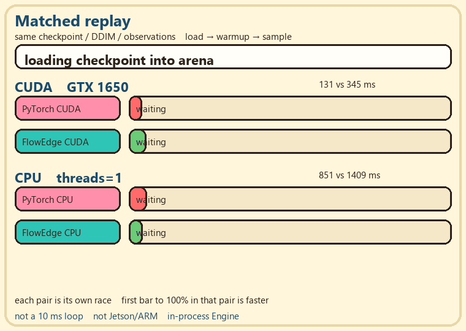

<div align="center">


# FlowEdge

**Low-latency inference for real-time robotics policies**

A C++23 inference runtime for robotics policies with fixed memory, deterministic execution, and explicit deadline handling. LeRobot still owns cameras, training, and the robot.

<br/>

&nbsp;**CPU** &nbsp;&nbsp;·&nbsp;&nbsp; &nbsp;**CUDA** &nbsp;&nbsp;·&nbsp;&nbsp; &nbsp;**Tenstorrent research track**

[Documentation](https://reforcemind.github.io/FlowEdge/) &nbsp;&nbsp;·&nbsp;&nbsp; [Getting Started](https://reforcemind.github.io/FlowEdge/getting-started.html) &nbsp;&nbsp;·&nbsp;&nbsp; [Python](https://reforcemind.github.io/FlowEdge/python-quickstart.html) &nbsp;&nbsp;·&nbsp;&nbsp; [Performance](https://reforcemind.github.io/FlowEdge/performance.html) &nbsp;&nbsp;·&nbsp;&nbsp; [Contributing](CONTRIBUTING.md)

</div>

<div align="center">
  
</div>

<p align="center"><em>Same load → warmup (malloc 0) → DDIM. CUDA 131 vs 345 ms. CPU 851 vs 1409 ms.</em></p>

## Overview

FlowEdge loads converted policy weights into a pre-sized arena and runs the
inference head in process. It is designed for bounded deployment paths where
allocation behavior, deadlines, and missed-action handling must be explicit.

- **Core** runs Mamba with flow matching or a Diffusion Policy U-Net with
  DDIM/DDPM.
- **LeRobot integration** keeps cameras, preprocessing, training, joint limits,
  and emergency stop outside the runtime.
- **Relay** is optional local IPC for deadline-aware jobs and action delivery.
- **Backends** are CPU and source-built CUDA. TT-Metal remains a research track.
- **APIs** are available for C, C++, and Python.

FlowEdge is not a trainer, general graph runtime, robot driver, or safety
controller.

## Installation

CPU wheels for CPython 3.10-3.12 are attached to the
[v0.1.2 release](https://github.com/reforcemind/FlowEdge/releases/tag/v0.1.2).
They are not published on PyPI, and CUDA is not included in the wheels.

```bash
python -m pip install flowedge-0.1.2-*.whl
mkdir -p models
curl -L "https://huggingface.co/ReForceMind/mamba_flow/resolve/main/mamba_flow.safetensors" \
  -o models/mamba_flow.safetensors
python examples/core/flow_sample.py models/mamba_flow.safetensors euler 10
```

### From source

FlowEdge requires CMake 3.21+ and a C++23 compiler.

```bash
git clone https://github.com/reforcemind/FlowEdge.git
cd FlowEdge
cmake -S . -B build -DCMAKE_BUILD_TYPE=Release
cmake --build build --config Release -j
./build/flow_sample models/mamba_flow.safetensors euler 10
```

For CUDA, configure with `-DFLOWEDGE_BACKEND=cuda`. This requires `nvcc`; the
published wheels remain CPU-only. See the [CUDA guide](docs/architecture/cuda.md).

## Diffusion Policy and LeRobot

The LeRobot plugin converts a pinned policy and runs a bounded rollout. A missed
period has an explicit `hold`, `drop`, or `raise` outcome.

```bash
python -m pip install -e integrations/lerobot
python -m flowedge_dev pipeline convert models/diffusion_pusht \
  models/diffusion_pusht.flowedge.safetensors --arch diffusion
python -m flowedge_dev pipeline rollout \
  models/diffusion_pusht.flowedge.safetensors \
  --steps 20 --threads 4 --period-ms 10 --on-miss hold
```

The period is a requested control interval, not a claim that the policy meets
it. Limits and emergency stop remain the robot adapter's responsibility.

## Relay

Relay is optional and is not used by the in-process Diffusion Policy replay.

```bash
cmake -S . -B build-relay -DCMAKE_BUILD_TYPE=Release -DFLOWEDGE_RELAY=ON
cmake --build build-relay -j
FLOWEDGE_BUILD_DIR=build-relay ./tools/scripts/relay_demo.sh \
  models/mamba_flow.safetensors
```

## Performance

On the published matched PushT Diffusion Policy replay, FlowEdge measured
851 ms versus 1409 ms for PyTorch on CPU (`threads=1`), and 131 ms versus
345 ms on a GTX 1650 CUDA run. These are checkpoint-specific policy medians,
not a 10 ms control-loop result. Commands, hardware, and limitations are in
[Performance](docs/performance.md).

## Verification

The full merge gate runs locally because checkpoint parity is not part of the
normal GitHub Actions test job.

```bash
./tools/scripts/verify_all.sh models/mamba_flow.safetensors
```

```powershell
powershell -File tools/scripts/verify_local.ps1 -BuildDir build-win-clang
```

Focused commands are available through the maintainer CLI:

```bash
python -m flowedge_dev --help
python -m flowedge_dev verify delivery smoke
```

See the [verification contract](docs/guides/verification.md) for the exact
coverage and evidence boundaries.

## Contributing

Bug fixes, tested model support, measurable kernel improvements, and simpler
implementations are welcome. Keep changes focused, add regression coverage,
and include same-host measurements for performance claims. See
[CONTRIBUTING.md](CONTRIBUTING.md).
