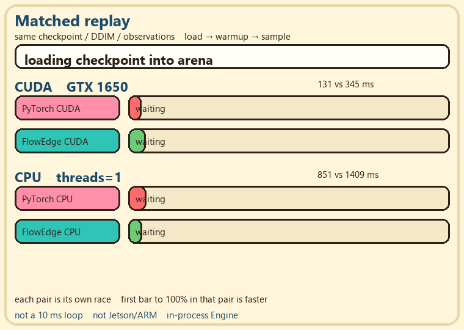

<div align="center">


# FlowEdge

**Low-latency inference runtime for real-time robotics policies**

A C++23 runtime engineered for bounded memory, deterministic execution, and explicit deadline handling.

<br/>

&nbsp;**CPU** &nbsp;&nbsp;·&nbsp;&nbsp; &nbsp;**CUDA** &nbsp;&nbsp;·&nbsp;&nbsp; &nbsp;**Tenstorrent research track**

[Documentation](https://reforcemind.github.io/FlowEdge/) &nbsp;&nbsp;·&nbsp;&nbsp; [Getting Started](https://reforcemind.github.io/FlowEdge/getting-started.html) &nbsp;&nbsp;·&nbsp;&nbsp; [Python Quickstart](https://reforcemind.github.io/FlowEdge/python-quickstart.html) &nbsp;&nbsp;·&nbsp;&nbsp; [Performance](https://reforcemind.github.io/FlowEdge/performance.html) &nbsp;&nbsp;·&nbsp;&nbsp; [Contributing](CONTRIBUTING.md)

</div>

<div align="center">
  
</div>

<p align="center"><em>End-to-end replay (load → warmup → zero-allocation DDIM). CUDA: 131 ms vs 345 ms. CPU: 851 ms vs 1409 ms.</em></p>

---

## Overview

FlowEdge takes the latency-critical action path out of heavy Python frameworks and executes it inside a pre-allocated C++23 memory arena. It is designed for robotics deployments where memory allocation, control deadlines, and missed-action behaviors must be deterministic and bounded.

- **Zero-allocation hot paths**: Memory is sized and pre-faulted at load; zero allocations occur during inference.
- **Supported policy heads**: Flow matching (Euler/Heun/RK4) and Diffusion Policy (DDIM/DDPM on Conv1D U-Net).
- **Clean ecosystem boundary**: LeRobot retains ownership of cameras, training, observation preprocessing, and hardware drivers.
- **Explicit deadline handling**: Configurable missed-action policies (`hold`, `drop`, `raise`) when control deadlines are exceeded.
- **Backends**: Optimized CPU SIMD (AVX2/NEON/scalar) and device-resident CUDA.
- **Relay (optional)**: Shared-memory lock-free IPC with deadline-aware Earliest Deadline First (EDF) dispatch.

FlowEdge focuses strictly on fast, bounded policy execution. It is not a model trainer, general graph compiler, robot driver, or safety controller.

---

## Quickstart

### Prebuilt wheels (CPU)

Prebuilt CPU wheels for CPython 3.10–3.12 are available on [GitHub Releases](https://github.com/reforcemind/FlowEdge/releases/tag/v0.1.2).

```bash
# Install the wheel matching your platform
python -m pip install flowedge-0.1.2-*.whl

# Download reference checkpoint and run a sample
mkdir -p models
curl -L "https://huggingface.co/ReForceMind/mamba_flow/resolve/main/mamba_flow.safetensors" \
  -o models/mamba_flow.safetensors
python examples/core/flow_sample.py models/mamba_flow.safetensors euler 10
```

### Build from source

Requires CMake 3.21+ and a C++23 compiler (Clang 16+, GCC 13+, or MSVC 19.38+):

```bash
git clone https://github.com/reforcemind/FlowEdge.git
cd FlowEdge

# Build CPU backend
cmake -S . -B build -DCMAKE_BUILD_TYPE=Release
cmake --build build --config Release -j
./build/flow_sample models/mamba_flow.safetensors euler 10
```

For CUDA, configure with `-DFLOWEDGE_BACKEND=cuda` (requires `nvcc`). See the [CUDA guide](docs/architecture/cuda.md).

### Python API

```python
import numpy as np
import flowedge

engine = flowedge.Engine("models/mamba_flow.safetensors")

# Sample an action chunk from token prefix and initial noise
prefix = np.array([1, 2, 3, 4], dtype=np.int32)
noise = np.random.randn(engine.action_dim).astype(np.float32)
action = engine.sample(prefix=prefix, noise=noise, steps=10, method="euler")
```

For zero-copy evaluation into caller-owned buffers, use `engine.run_into()` and `engine.sample_into()`. See the [Python API guide](docs/api/python.md).

---

## LeRobot & Diffusion Policy

The LeRobot integration converts a trained policy checkpoint and executes the native action head with explicit control loop timing:

```bash
# Install LeRobot adapter
python -m pip install -e integrations/lerobot

# Convert checkpoint
python -m flowedge_dev pipeline convert models/diffusion_pusht \
  models/diffusion_pusht.flowedge.safetensors --arch diffusion

# Run a bounded rollout test with explicit missed-deadline handling
python -m flowedge_dev pipeline rollout \
  models/diffusion_pusht.flowedge.safetensors \
  --steps 20 --threads 4 --period-ms 10 --on-miss hold
```

Missed deadline behaviors:
- `hold`: Repeat the previous valid action.
- `drop`: Skip transmission for this step.
- `raise`: Halt execution and raise a deadline exception.

---

## Performance

Matched PushT Diffusion Policy replay against PyTorch / LeRobot (median latency, lower is better):

| Backend | Hardware / Threads | FlowEdge | PyTorch / LeRobot | Speedup |
|---|---|---:|---:|---:|
| **CPU** | 1 thread | **851 ms** | 1409 ms | 1.66× |
| **CPU** | 4 threads | **633 ms** | 819 ms | 1.29× |
| **CUDA** | GeForce GTX 1650 | **131 ms** | 345 ms | 2.63× |

All comparisons use identical observations, normalization statistics, initial noise, and 10-step DDIM schedules. For complete benchmark data and reproduction commands, see [Performance Documentation](docs/performance.md).

---

## Verification

FlowEdge maintains strict verification gates for parity, memory bounds, and latency:

```bash
# Linux / macOS / Git Bash
./tools/scripts/verify_all.sh models/mamba_flow.safetensors

# Windows PowerShell
powershell -File tools/scripts/verify_local.ps1 -BuildDir build-win-clang
```

Focused verification tasks via the CLI:

```bash
# Verify numerical parity with PyTorch
python -m flowedge_dev verify ulp models/mamba_flow.safetensors
python -m flowedge_dev verify diffusion build
```

See the [Verification Contract](docs/guides/verification.md) for full coverage details.

---

## Relay (Optional IPC)

Relay provides lock-free, zero-copy shared-memory IPC for multi-process robotics pipelines (e.g. vision or VLA in one process, controller in another):

```bash
cmake -S . -B build-relay -DCMAKE_BUILD_TYPE=Release -DFLOWEDGE_RELAY=ON
cmake --build build-relay -j
FLOWEDGE_BUILD_DIR=build-relay ./tools/scripts/relay_demo.sh models/mamba_flow.safetensors
```

See the [Relay Quickstart](docs/guides/relay-quickstart.md) for architecture and deployment configurations.

---

## Contributing

Contributions are welcome. Please read [CONTRIBUTING.md](CONTRIBUTING.md) and our [Code of Conduct](CODE_OF_CONDUCT.md) before submitting pull requests.

License: Apache 2.0
